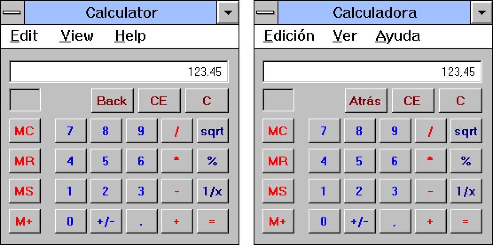

# win31-calc95

**The Windows 95 calculator look, on Windows 3.1.**
A native 16-bit (Win16) calculator written in C that brings the 1995 interface back to 1992, ready for real 486 hardware.

<p align="center">
  
  <br>
  <sub>Right: captured on a real 486 running Windows 3.1 in Spanish. Left: the same capture with the English UI texts.</sub>
</p>

### Highlights

- **Windows 95 look, inside Windows 3.1.** Windows 3.1 draws the window frame and menu bar. The client area is custom-painted: 3D bevelled buttons, MS Sans Serif 8 pt, and blue/red/navy key labels.
- **VGA-friendly.** Only the 16 standard VGA colors are used, so it looks right on a plain VGA card without a 256-color driver.
- **Speaks your language.** English by default, Spanish when Windows is set to Spanish. The decimal separator follows the regional settings.
- **Small and dependency-free.** One ~32 KB executable that needs no math coprocessor and imports only system DLLs.

## Status

| Phase | Scope | State |
|---|---|---|
| 1 | Standard mode, English/Spanish localization | Done, tested on a real 486 |
| 2 | Scientific mode | Planned |
| 3 | Windows 3.x–style setup floppy (1.44 MB image) | Planned |

## Features (phase 1)

- Standard mode with Windows 95 behavior:
  - chained left-to-right evaluation and repeatable `=`;
  - `%` relative to the accumulator;
  - `sqrt` and `1/x`;
  - Back (backspace), CE and C;
  - MC/MR/MS/M+ memory with an "M" indicator.
- Mouse buttons that stay pressed while held. Full keyboard support.
- Copy and paste through the clipboard (`Ctrl+C` / `Ctrl+V`).
- Localization, read once at startup:
  - The UI language comes from `WIN.INI [intl] sLanguage`. Values starting with `es` give Spanish; anything else, or a missing value, gives English.
  - The decimal separator comes from `WIN.INI [intl] sDecimal`.
- Icon: extracted at runtime from `<WINDOWS>\CALC31.EXE`, the original calculator, which the installer will back up under that name. If that file is missing, a built-in fallback icon is used.
- No math coprocessor required. Imports only KERNEL, USER, GDI, SHELL and KEYBOARD.

## Requirements

- Windows 3.1 or 3.11, in standard or 386 enhanced mode.
- To build:
  - [Open Watcom v2](https://github.com/open-watcom/open-watcom-v2), which runs on Linux, Windows or macOS;
  - `python3` and `iconv`, used to generate the icon and convert the resource script to Windows-1252.

## Building

```sh
export WATCOM=/path/to/open-watcom
export PATH=$WATCOM/binl64:$WATCOM/binl:$PATH   # use the bin directory for your host
export INCLUDE=$WATCOM/h:$WATCOM/h/win
./build.sh
```

The executable is written to `build/CALC.EXE`.

Engine tests run on the host with any C compiler:

```sh
cd test
gcc -I../src test_engine.c ../src/engine.c -lm -o test_engine && ./test_engine
```

## Trying it on Windows 3.1

Until the installer exists, keep the original calculator untouched:

1. Copy `CALC.EXE` to its own folder, for example `C:\CALC95\`.
2. In Program Manager, choose File › New › Program Item and set the command line to `C:\CALC95\CALC.EXE`.
3. Optional: to get the original icon, run `COPY C:\WINDOWS\CALC.EXE C:\WINDOWS\CALC31.EXE`.
4. To try the other language, change the language in Control Panel › International and restart the calculator.

## Keyboard

| Key | Function |
|---|---|
| `0`–`9`, `.` or `,` | Digits and decimal separator |
| `+` `-` `*` `/` | Operators |
| `Enter` or `=` | Equals |
| `%` | Percent |
| `@` | Square root |
| `R` | 1/x |
| `F9` | +/- |
| `Backspace` | Backspace |
| `Del` | CE |
| `Esc` | C |
| `Ctrl+L` / `Ctrl+R` / `Ctrl+M` / `Ctrl+P` | MC / MR / MS / M+ |
| `Ctrl+C` / `Ctrl+V` | Copy / Paste |

## Project layout

```
src/
  engine.c, engine.h    Calculator logic (no Windows dependencies)
  calc.c                Window, painting, mouse, keyboard, clipboard
  calc.rc.utf8          Menus and strings (EN/ES), converted to CP1252 at build time
  resource.h            Resource identifiers
tools/make_icon.py      Generates the fallback 32x32, 16-color icon
test/test_engine.c      Host-side engine tests
build.sh                Build script (Open Watcom v2)
```

## Disclaimer

This is an independent hobby project and is not affiliated with or endorsed by Microsoft. Windows is a trademark of Microsoft Corporation. The repository contains no Microsoft code, images or icons.

## License

[MIT](LICENSE)
