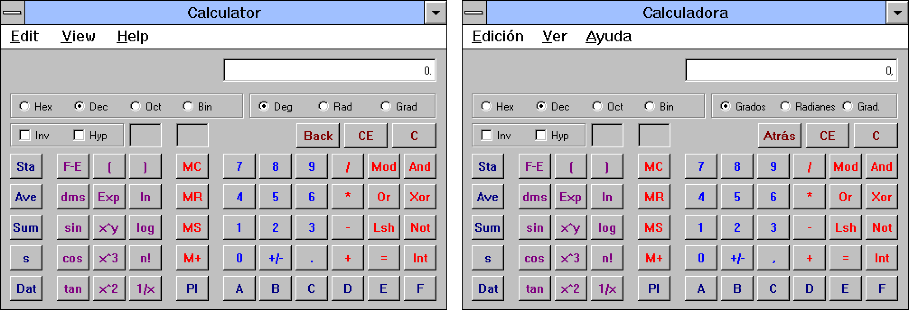

# win31-calc95

**The Windows 95 calculator look, on Windows 3.1.**
A native 16-bit (Win16) calculator written in C that brings the 1995 interface back to 1992, ready for real 486 hardware.

<p align="center">
  
  <br>
  <sub>Right: captured on a real 486 running Windows 3.1 in Spanish. Left: the same capture with the English UI texts.</sub>
</p>

<p align="center">
  
  <br>
  <sub>Scientific mode, rendered pixel by pixel from the app's layout and the Windows 3.1 fonts (not a capture).</sub>
</p>

### Highlights

- **Windows 95 look, inside Windows 3.1.** Windows 3.1 draws the window frame and menu bar. The client area is custom-painted: 3D bevelled buttons, MS Sans Serif 8 pt, and blue/red/navy key labels.
- **VGA-friendly.** Only the 16 standard VGA colors are used, so it looks right on a plain VGA card without a 256-color driver.
- **Speaks your language.** English by default, Spanish when Windows is set to Spanish. The decimal separator follows the regional settings.
- **Small and dependency-free.** One ~32 KB executable that needs no math coprocessor and imports only system DLLs.

## Status

| Phase | Scope | State |
|---|---|---|
| 1 | Standard mode, English/Spanish localization | Done, tested on a real 486 |
| 2 | Scientific mode | Done, tested on a real 486 |
| 3 | Setup and uninstall floppy (1.44 MB image) | Done, tested |

## Features

- Standard mode with Windows 95 behavior:
  - chained left-to-right evaluation and repeatable `=`;
  - `%` relative to the accumulator;
  - `sqrt` and `1/x`;
  - Back (backspace), CE and C;
  - MC/MR/MS/M+ memory with an "M" indicator.
- Scientific mode with Windows 95 behavior (View › Scientific):
  - operator precedence (`2 + 3 * 4 = 14`) and up to 25 levels of parentheses, with a `(=n` indicator;
  - Hex/Dec/Oct/Bin with Dword/Word/Byte word sizes (two's complement), and Deg/Rad/Grad angles;
  - `sin` `cos` `tan` `ln` `log` `x^y` `x^2` `x^3` `n!` `1/x` `dms` `Exp` `F-E` `PI`, with `Inv` and `Hyp`;
  - `Mod` `And` `Or` `Xor` `Lsh` `Not` `Int`;
  - Statistics box (`Sta`, `Ave`, `Sum`, `s`, `Dat`).
- The last view is remembered in `WIN.INI [SciCalc] layout` (0 = Scientific, 1 = Standard).
- Mouse buttons that stay pressed while held. Full keyboard support.
- Copy and paste through the clipboard (`Ctrl+C` / `Ctrl+V`).
- Localization, read once at startup:
  - The UI language comes from `WIN.INI [intl] sLanguage`. Values starting with `es` give Spanish; anything else, or a missing value, gives English.
  - The decimal separator comes from `WIN.INI [intl] sDecimal`.
- Icon: extracted at runtime from `<WINDOWS>\CALC31.EXE`, the original calculator, which the installer will back up under that name. If that file is missing, a built-in fallback icon is used.
- No math coprocessor required. Imports only KERNEL, USER, GDI, SHELL and KEYBOARD.

## Requirements

- Windows 3.1 or 3.11, in standard or 386 enhanced mode.
- To build:
  - [Open Watcom v2](https://github.com/open-watcom/open-watcom-v2), which runs on Linux, Windows or macOS;
  - `python3` and `iconv`, used to generate the icon and convert the resource scripts to Windows-1252;
  - `mtools` and `zip`, for the floppy image.

## Building

```sh
export WATCOM=/path/to/open-watcom
export PATH=$WATCOM/binl64:$WATCOM/binl:$PATH   # use the bin directory for your host
export INCLUDE=$WATCOM/h:$WATCOM/h/win
./build.sh
```

`build.sh` writes `CALC.EXE`, `SETUP.EXE` and `UNINSTAL.EXE` to `build/`. To make the floppy image and the zip (needs `mtools` and `zip`):

```sh
./tools/make_floppy.sh      # build/dist/CALC95.IMG and build/dist/calc95-disk.zip
```

Engine tests run on the host with any C compiler:

```sh
cd test
gcc -I../src test_engine.c ../src/engine.c -lm -o test_engine && ./test_engine
gcc -I../src test_sci.c ../src/sci.c -lm -o test_sci && ./test_sci
```

## Installing on Windows 3.1

Download `CALC95.IMG` (a 1.44 MB floppy image) or `calc95-disk.zip` from the Releases page, write it to a floppy disk or copy the files to any folder, and run `SETUP.EXE` from File Manager or Program Manager (File › Run).

Setup:

1. renames the original `<WINDOWS>\CALC.EXE` to `CALC31.EXE` (if it is already this calculator, it is only updated);
2. copies the new calculator as `<WINDOWS>\CALC.EXE`;
3. replaces the Calculator icon in Program Manager in place, using the original Calculator icon (the calculator also uses it when minimized);
4. records what it changed in `WIN.INI [Calc95]`.

`UNINSTAL.EXE`, on the same disk, puts everything back as it was: the original `CALC.EXE`, the Program Manager icon and `WIN.INI`. Neither program is copied to your system.

Notes:

- Both programs ask you to close Calculator first, and Setup never overwrites an existing `CALC31.EXE`.
- The calculator's module name is `CALC95`, so it can run next to the original (`CALC31.EXE`).

## Keyboard

| Key | Function |
|---|---|
| `0`–`9`, `.` or `,` | Digits and decimal separator |
| `+` `-` `*` `/` | Operators |
| `Enter` or `=` | Equals |
| `%` | Percent (Standard) / Mod (Scientific) |
| `@` | Square root (Standard) / x^2 (Scientific) |
| `R` | 1/x |
| `F9` | +/- |
| `Backspace` | Backspace |
| `Del` | CE |
| `Esc` | C |
| `Ctrl+L` / `Ctrl+R` / `Ctrl+M` / `Ctrl+P` | MC / MR / MS / M+ |
| `Ctrl+C` / `Ctrl+V` | Copy / Paste |

Scientific mode adds:

| Key | Function | Key | Function |
|---|---|---|---|
| `S` `O` `T` | sin, cos, tan | `(` `)` | Parentheses |
| `N` `L` | ln, log | `&` `\|` `^` | And, Or, Xor |
| `Y` `#` `!` | x^y, x^3, n! | `<` `~` `;` | Lsh, Not, Int |
| `M` `X` `V` `P` | dms, Exp, F-E, PI | `A`–`F` | Hex digits |
| `I` `H` | Inv, Hyp | `F5` `F6` `F7` `F8` | Hex, Dec, Oct, Bin |
| `Ctrl+S` | Statistics box | `F2` `F3` `F4` | Dword/Word/Byte or Deg/Rad/Grad |
| `Ctrl+A` `Ctrl+T` `Ctrl+D` | Ave, Sum, s | `Ins` | Dat |

## Project layout

```
src/
  engine.c, engine.h    Standard mode logic (no Windows dependencies)
  sci.c, sci.h          Scientific mode logic (no Windows dependencies)
  calc.c                Window, painting, mouse, keyboard, clipboard
  calc.rc.utf8          Menus and strings (EN/ES), converted to CP1252 at build time
  resource.h            Resource identifiers
setup/setup.c           SETUP.EXE and UNINSTAL.EXE (same source, built twice)
setup/setup.rc.utf8     Installer strings (EN/ES)
tools/make_icon.py      Generates the fallback 32x32, 16-color icon
tools/make_floppy.sh    Builds the 1.44 MB setup floppy image and zip
test/test_*.c           Host-side engine tests
build.sh                Build script (Open Watcom v2)
```

## Disclaimer

This is an independent hobby project and is not affiliated with or endorsed by Microsoft. Windows is a trademark of Microsoft Corporation. The repository contains no Microsoft code, images or icons.

## License

[MIT](LICENSE)
